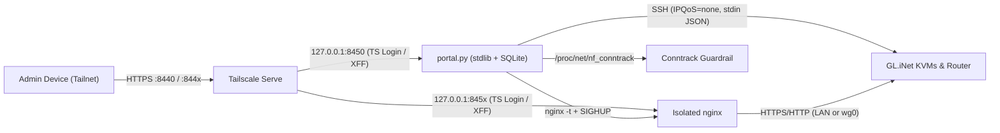
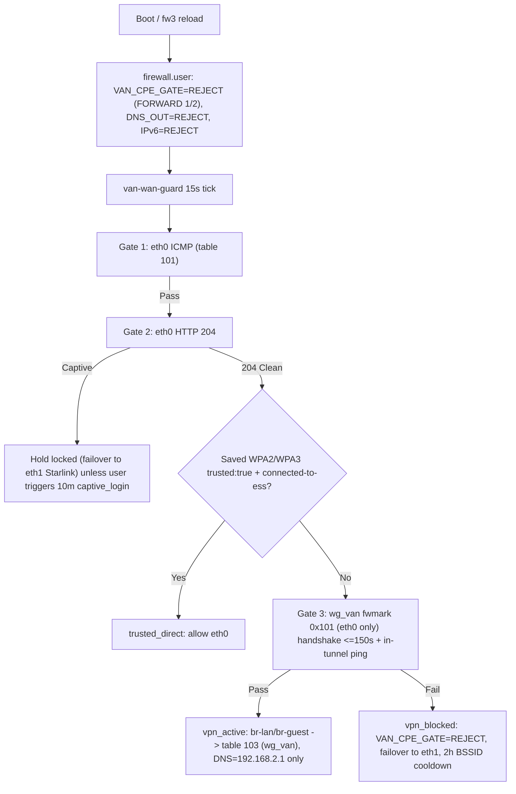

# Architecture

## 1. Private Management Plane (Gateway Host)

- **State Hydration**: Device resolution, latest triage sweeps, and conntrack alerts persist in SQLite (`state.db`) and reload on startup.
- **Zero-Disruption Reloads**: `nginx_sync.py` writes `upstreams.conf` atomically, verifies with `nginx -t`, rolls back on syntax failure, and sends `SIGHUP` only when resolved IPs change.

## 2. Fail-Closed VPN Gate & Multi-WAN Routing (OpenWrt Router)

### Policy Routing Table Layout (`ip rule`)

| Priority | Match | Action / Table | Purpose |
| :--- | :--- | :--- | :--- |
| `85` | `fwmark 0x101` | `lookup 101` (`eth0`) | Pins `wg_van` encrypted UDP transport strictly to `eth0` |
| `86` | `fwmark 0x101` | `unreachable` | Prevents `wg_van` from ever falling through to Starlink (`eth1`) |
| `88` | `from 192.168.2.5/32` | `lookup 104` (`wg_mgmt`) | Isolates split-tunnel management replies from `wg_van` |
| `89` | `from 192.168.2.6/32` | `lookup 103` (`wg_van`) | Routes Gate 3 probes strictly inside `wg_van` |
| `90` | `from 192.168.2.6/32` | `unreachable` | Prevents Gate 3 probes from ever falling through to Starlink |
| `91` / `92` | `to 192.168.88.1` / `192.168.100.1` | `lookup 101` / `102` | Direct management reachability to CPE and Starlink dish |
| `93` | `to 192.168.2.1/32` | `lookup 103` (`wg_van`) | Active only in `vpn_active`; sends router `dnsmasq` queries inside tunnel |
| `94` | Local `br-*` CIDRs | `lookup main` | Discovered dynamically; preserves local LAN/guest routing when `table 103` is active |
| `95` / `96` | `iif br-lan` / `br-guest` | `lookup 103` (`wg_van`) | Installed only after Gate 3 passes; steers all client egress into `wg_van` |
| `97` / `98` | `iif br-lan` / `br-guest` | `unreachable` | Active in `vpn_active`; prevents fallback to Starlink if `wg_van` flaps between ticks |
| `101` / `102` | `from <eth0_ip>` / `<eth1_ip>` | `lookup 101` / `102` | Source-routes daemon probes out their respective WAN interfaces |
